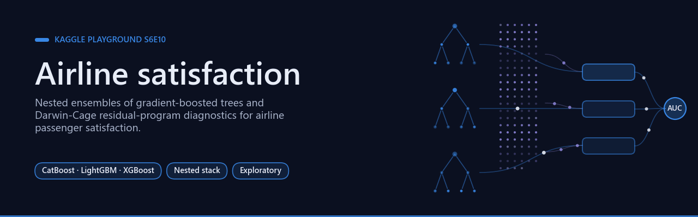
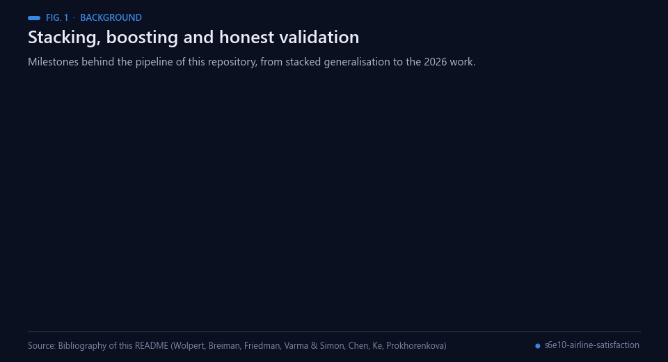
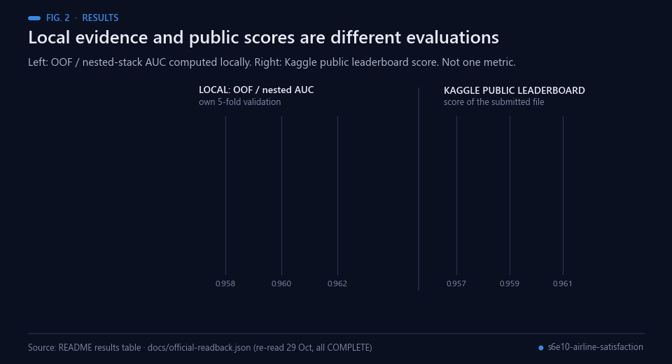
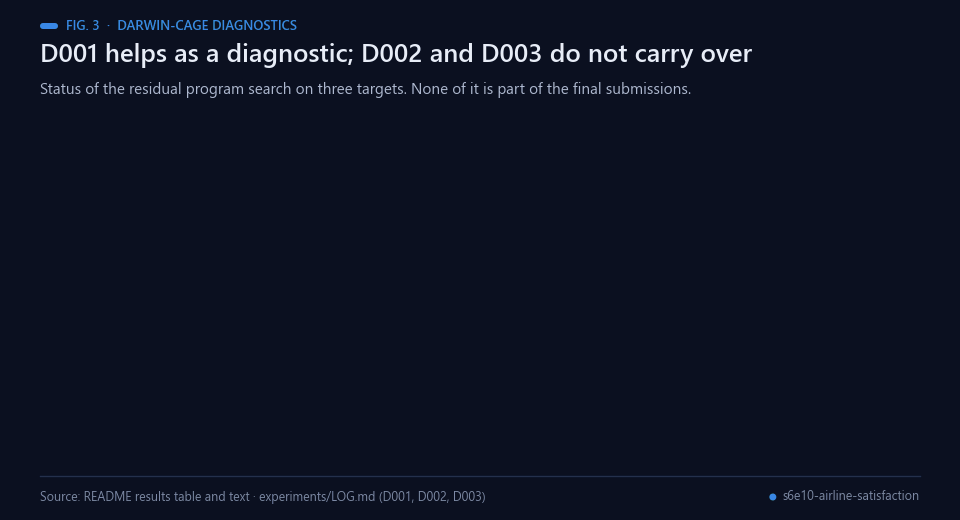
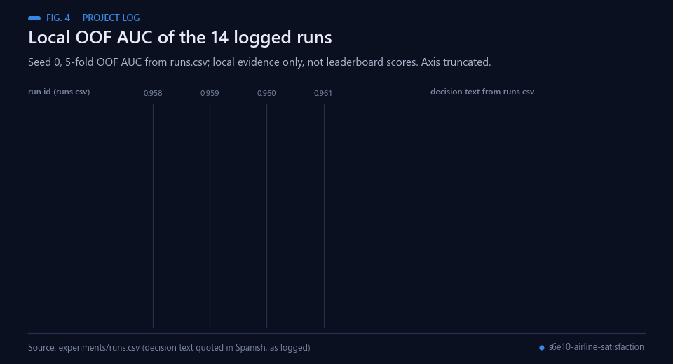
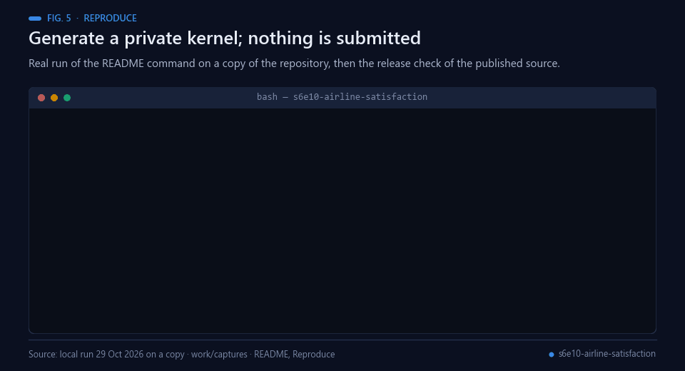
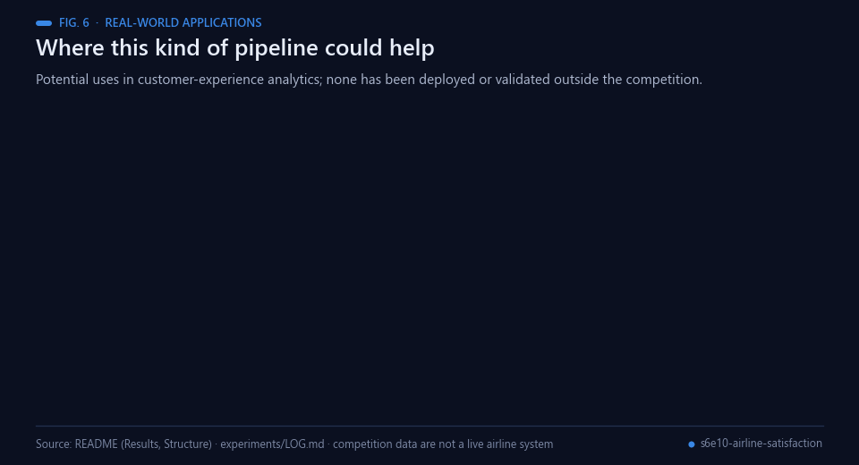
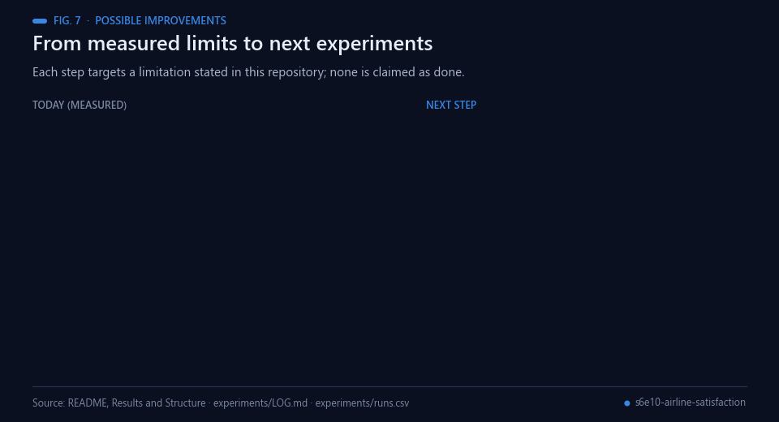
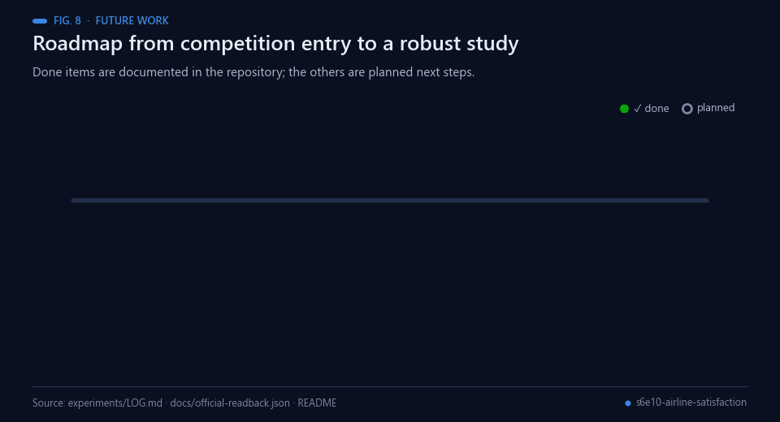
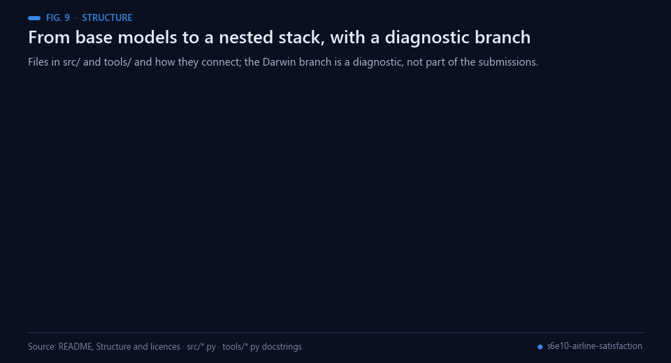

<div align="center">



# Airline satisfaction — nested ensembles and Darwin-Cage diagnostics

[](https://github.com/Agnuxo1/s6e10-airline-satisfaction/actions/workflows/release.yml) [](LICENSE)  [](docs/RESEARCH_PROTOCOL.md) [](https://www.kaggle.com/competitions/playground-series-s6e10)

[**Results**](#results-and-contribution) · [**Reproduce**](#reproduce) · [**Structure**](#structure-and-licences) · [**Official readback**](docs/official-readback.json) · [**Experiment log**](experiments/LOG.md) · [**Research protocol**](docs/RESEARCH_PROTOCOL.md) · [**Bibliography**](#bibliography)

</div>

Reproducible project for [Kaggle Playground S6E10](https://www.kaggle.com/competitions/playground-series-s6e10). CatBoost, LightGBM and XGBoost form the predictive control; our Darwin-Cage program search tests structured residual hypotheses. Public prediction libraries are credited separately.

**Contents** — [Background](#background) · [Results and contribution](#results-and-contribution) · [Reproduce](#reproduce) · [Real-world applications](#real-world-applications) · [Possible improvements](#possible-improvements) · [Future work](#future-work) · [Structure and licences](#structure-and-licences) · [Bibliography](#bibliography)

## Background

<p align="center"><br><sub>Fig. 1 — Milestones behind the pipeline. Sources: bibliography below.</sub></p>

The pipeline combines three well-established ideas. *Stacked generalisation* trains a second-level model on the
held-out predictions of first-level models [[2](#ref-2)], and stacked regressions showed how to combine such predictions
for better accuracy than any single member [[3](#ref-3)]. The first-level models here are gradient-boosted decision
trees [[1](#ref-1)], in the three widely used implementations XGBoost [[4](#ref-4)], LightGBM [[5](#ref-5)] and CatBoost
[[6](#ref-6)], the last designed with categorical features in mind. Ensemble members can also be chosen greedily from a
library of models by hill climbing [[11](#ref-11)], the approach used by the repository's blending tool.

Because the stack and its members are tuned on the same data, honest evaluation matters: selecting a model with
cross-validation and then reporting that same cross-validation score is optimistically biased, which is why nested
validation is used instead [[7](#ref-7)]. The metric throughout is the area under the ROC curve [[8](#ref-8)]; the
competition is Kaggle Playground Series S6E10 [[12](#ref-12)], with the original airline-satisfaction rows available as an
optional extra training source [[15](#ref-15)].

Darwin-Cage belongs to a different tradition: searching a space of small programs for structure that data support,
as in symbolic regression [[9](#ref-9)] and genetic programming [[10](#ref-10)]. Here it is used only as a diagnostic on model
residuals. Its core, `src/darwin_core.py`, is taken verbatim from the author's earlier public repository
[s6e9-honest-ceiling](https://github.com/Agnuxo1/s6e9-honest-ceiling) [[13](#ref-13)], which applied the same search to the
previous Playground episode. The 124-member public prediction library used in the final stack is credited separately
[[14](#ref-14)].

## Results and contribution

<p align="center"><br><sub>Fig. 2 — Local evidence (left) and Kaggle public scores (right) are different evaluations. Data: the table below and docs/official-readback.json.</sub></p>

| Experiment | Local evidence | Official public score recorded in project log |
|---|---|---|
| E001 CatBoost baseline | OOF AUC 0.958327 |0.95798, submission 57736176 |
| E014 feature/categorical model | OOF AUC 0.960984 | Not assigned a separate official score here |
| B001, 14 own GBDTs | nested/LOFO stack AUC 0.961244 |0.96083, submission 57759629 |
| S001, 14 own+124 public members | nested stack AUC 0.962066 |0.96166, submission 57759904 |
| D001 Darwin residual study | single-model held-out fold0.95858→0.95959 | Diagnostic gain, not official gain |
| D002 Darwin on own blend, 3 seeds |1/0/1 programs confirmed; applying them lowers AUC about0.0006 | Rejected for final blend |
| D003 Darwin on full stack, 3 seeds |0/0/0 programs confirmed; calibration-only change−0.000004 | No contribution established on final stack |

<p align="center"><br><sub>Fig. 3 — Darwin-Cage diagnostics as stated in the table; the improvement from public members is not attributed to Darwin-Cage.</sub></p>

<p align="center"><br><sub>Fig. 4 — Project log: local OOF AUC per run (seed 0). Data: experiments/runs.csv; decisions quoted in Spanish as logged.</sub></p>

The improvement from public members is **not attributed to Darwin-Cage**. D001 remains a positive result: independent program search finds the route interaction later absorbed by the stronger control. D002/D003 do not erase it, and D001 does not establish a final-ensemble gain. The three official scores above were independently re-read through the authenticated Kaggle API on 29October; all three entries are COMPLETE. [Dated official readback](docs/official-readback.json). See [complete log](experiments/LOG.md) and [configurations](experiments/configs).

## Reproduce

<p align="center"><br><sub>Fig. 5 — Real run of the README command on a copy (it only writes a private kernel folder), then the release check output.</sub></p>

Python 3.11+, Kaggle account already eligible for the competition, and the allowed original-data/public-member sources listed in the selected configuration:

```bash
python -m pip install -r requirements.txt
python tools/make_kernel.py experiments/configs/e001.json --cpu
```

This generates a **private** Kaggle kernel under `kernels/`; it does not submit anything. Inspect its data/model/notebook sources before uploading with Kaggle CLI. The source files are notebook bodies; `tools/make_kernel.py` injects `CONFIG`. OOF predictions, labels, public prediction libraries, datasets and submissions are obtained externally and are not redistributed here. Full stack reproduction requires the 124-member public library and exact shared folds. CPU/GPU platform differences can affect timings and fitted models.

## Real-world applications

<p align="center"><br><sub>Fig. 6 — Potential uses; none has been deployed or validated outside the competition.</sub></p>

Customer-experience analytics is the natural setting for this kind of model. The competition data are not a live
airline system, so the following are potential uses of the methods, not achieved results:

- **Satisfaction prediction.** Rank passengers by the likelihood of reporting satisfaction from survey ratings and
  trip fields, evaluated by AUC as in the competition.
- **Driver analysis.** The logged runs compare representations (ratings and other columns as categories, a route
  identifier built from Flight Distance); the same comparison could show which inputs carry signal in other surveys.
- **Route-level monitoring.** Route-like keys that helped the models could also flag route-specific service issues.
- **Fold-safe ensembling.** The nested stack and leave-one-fold-out blend are a template for other tabular binary
  tasks.
- **Auditable experiment logs.** Configurations, `runs.csv` and `LOG.md` keep negative results next to positive ones.
- **Residual-structure checks.** The Darwin-Cage diagnostic asks whether a strong model leaves group structure in its
  residuals before more complexity is added.

## Possible improvements

<p align="center"><br><sub>Fig. 7 — Each improvement targets a limitation stated in this repository.</sub></p>

- **Evidence level.** Public-leaderboard selection is exploratory and not a hidden-test generalisation guarantee.
  Hidden-test results, when available, should be reported next to the nested-CV estimates, which remain the primary
  local evidence [[7](#ref-7)].
- **Dependence on public members.** The log attributes +0.00082 of the final stack over the own-model blend to the
  124 public members. More diverse own members (other seeds, other model families) would show how far the own
  pipeline reaches alone.
- **Darwin programs.** No program was confirmed on the final stack (D003: 0/0/0). Other residual targets or program
  alphabets could be tried, keeping the search a diagnostic until a gain survives several seeds.
- **Seeds and folds.** The logged runs use seed 0 and one fold split; repeating key runs would give the spread.
- **Reproduction inputs.** Full reproduction needs external predictions, data and exact shared folds; checksums and a
  documented small CPU path would make verification easier.

## Future work

<p align="center"><br><sub>Fig. 8 — Completed milestones are documented in this repository; the rest are planned.</sub></p>

Planned next steps, in order; none is claimed as started:

1. Repeat the key own-model runs over several seeds and fold splits and report the spread.
2. Add more diverse own members to the stack and measure the result without the public library.
3. Report the hidden-test outcome next to the local and public numbers once it is available.
4. Test other residual targets and program alphabets for Darwin-Cage under the same confirmation rule.
5. Add checksums for the external inputs and a short CPU-only verification path.

## Structure and licences

<p align="center"><br><sub>Fig. 9 — Code structure as described in this section. Sources: src/*.py and tools/*.py.</sub></p>

`src/runner_body.py`: base models; `stack_body.py`: nested stack; `darwin_core.py` and `darwin_body.py`: own residual search; `tools/`: packaging and fold-safe diagnostics. External credit: public library **cdeotte124** and dataset `arseniyshutko/binary-aviation-satisfaction-129k`; their source terms still apply. Code developed here: MIT. Follow [research protocol](docs/RESEARCH_PROTOCOL.md). Public-leaderboard selection remains exploratory, not a hidden-test generalisation guarantee.

## Bibliography

1. <a id="ref-1"></a>Friedman, J. H. (2001). Greedy function approximation: A gradient boosting machine. *The Annals of Statistics*, 29(5), 1189–1232. https://doi.org/10.1214/aos/1013203451
2. <a id="ref-2"></a>Wolpert, D. H. (1992). Stacked generalization. *Neural Networks*, 5(2), 241–259. https://doi.org/10.1016/S0893-6080(05)80023-1
3. <a id="ref-3"></a>Breiman, L. (1996). Stacked regressions. *Machine Learning*, 24(1), 49–64. https://doi.org/10.1007/BF00117832
4. <a id="ref-4"></a>Chen, T., & Guestrin, C. (2016). XGBoost: A scalable tree boosting system. *Proceedings of the 22nd ACM SIGKDD International Conference on Knowledge Discovery and Data Mining*, 785–794. https://doi.org/10.1145/2939672.2939785
5. <a id="ref-5"></a>Ke, G., Meng, Q., Finley, T., Wang, T., Chen, W., Ma, W., Ye, Q., & Liu, T.-Y. (2017). LightGBM: A highly efficient gradient boosting decision tree. *Advances in Neural Information Processing Systems 30 (NIPS 2017)*. https://papers.nips.cc/paper/2017/hash/6449f44a102fde848669bdd9eb6b76fa-Abstract.html
6. <a id="ref-6"></a>Prokhorenkova, L., Gusev, G., Vorobev, A., Dorogush, A. V., & Gulin, A. (2017). CatBoost: unbiased boosting with categorical features. *arXiv* 1706.09516. https://arxiv.org/abs/1706.09516
7. <a id="ref-7"></a>Varma, S., & Simon, R. (2006). Bias in error estimation when using cross-validation for model selection. *BMC Bioinformatics*, 7, 91. https://doi.org/10.1186/1471-2105-7-91
8. <a id="ref-8"></a>Hanley, J. A., & McNeil, B. J. (1982). The meaning and use of the area under a receiver operating characteristic (ROC) curve. *Radiology*, 143(1), 29–36. https://doi.org/10.1148/radiology.143.1.7063747
9. <a id="ref-9"></a>Schmidt, M., & Lipson, H. (2009). Distilling Free-Form Natural Laws from Experimental Data. *Science*, 324(5923), 81–85. https://doi.org/10.1126/science.1165893
10. <a id="ref-10"></a>Koza, J. R. (1994). Genetic programming as a means for programming computers by natural selection. *Statistics and Computing*, 4(2), 87–112. https://doi.org/10.1007/BF00175355
11. <a id="ref-11"></a>Caruana, R., Niculescu-Mizil, A., Crew, G., & Ksikes, A. (2004). Ensemble selection from libraries of models. *Proceedings of the 21st International Conference on Machine Learning (ICML '04)*, 18. https://doi.org/10.1145/1015330.1015432
12. <a id="ref-12"></a>Kaggle. *Predicting Airline Satisfaction* (Playground Series, Season 6 Episode 10). Competition page. https://www.kaggle.com/competitions/playground-series-s6e10
13. <a id="ref-13"></a>Angulo de Lafuente, F. (2026). *s6e9-honest-ceiling*: fold-safe ensembling and a Darwin-Cage residual search for Kaggle Playground S6E9 (Apache-2.0). GitHub repository. https://github.com/Agnuxo1/s6e9-honest-ceiling
14. <a id="ref-14"></a>cdeotte. *S6E10: 124 public OOF and test predictions*. Kaggle dataset (public prediction library credited in this repository; licence listed as unknown). https://www.kaggle.com/datasets/cdeotte/s6e10-124-public-oof-and-test-predictions
15. <a id="ref-15"></a>arseniyshutko. *binary-aviation-satisfaction-129k*. Kaggle dataset (original airline-satisfaction data used as optional extra training rows). https://www.kaggle.com/datasets/arseniyshutko/binary-aviation-satisfaction-129k

---

<div align="center">
<sub>Built by <a href="https://github.com/Agnuxo1">Francisco Angulo de Lafuente</a> · every figure is an animated
rendering of the published file named in its footer · <a href="#airline-satisfaction--nested-ensembles-and-darwin-cage-diagnostics">back to top ↑</a></sub>
</div>
